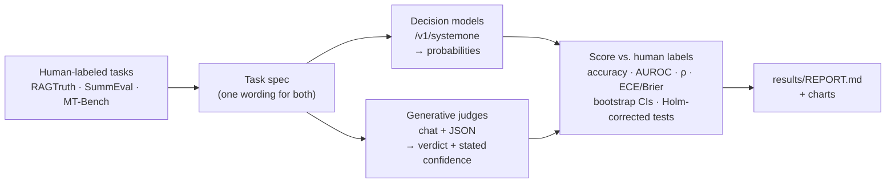

# judgment-calls

*judgment call: a decision that requires judgment.*

**Can OpenRouter's new decision models replace a generative LLM-as-a-judge?** This repo runs both
kinds of judge on the same human-labeled tasks, with the same wording, and compares accuracy,
calibration, cost and latency, with confidence intervals and paired significance tests.

## TL;DR

- **Yes for hallucination checks and rubric scores.** The best decision model (`jev-1.13`)
  matched or beat Claude Haiku 5.5 and GPT-6 Luna. Claude Sonnet 5.5, at 80× the cost, beat a
  decision model in only 1 of 24 paired tests on a reference subset (d1, on score agreement).
- **About 3–4× cheaper and 3× faster**: $0.06 vs. $0.17–0.25 per 1,000 judgments, and
  0.4 s vs. 1.4 s median latency.
- **Their confidence means something.** GPT-6 Luna says "≥90% sure" on every faithfulness call
  and is wrong a quarter of the time. Decision models are wrong 0–9% of the time at that
  confidence.
- **Not proven for pairwise preference**: no judge of either kind beats another there.

## How it works



| Task | Question type | Human labels | Items |
|---|---|---|---|
| Hallucination detection | yes/no | RAGTruth span annotations | 200 |
| Summary quality | 1–5 score | SummEval expert ratings | 200 |
| Which answer is better | A / B / tie | MT-Bench expert votes (both orders) | 150 |

## Results

| Judge | Type | Hallucination (balanced acc.) | Summary score (Spearman ρ) | $ / 1k | p50 |
|---|---|---|---|---|---|
| **typesafe/jev-1.13** | decision | **0.82** | **0.73** | **$0.06** | 0.44 s |
| openai/gpt-6-luna-decisions | decision | 0.75 | 0.69 | $0.14 | 0.39 s |
| cloudflare/clef | decision | 0.69 | 0.73 | $0.07 | 0.57 s |
| liquid/d1 | decision | 0.69 | 0.72 | $0.07 | 0.46 s |
| openai/gpt-6-luna | generative | 0.75 | 0.70 | $0.17 | 1.37 s |
| anthropic/claude-haiku-5.5 | generative | 0.67 | 0.61 | $0.25 | 1.51 s |

95% CIs are about ±0.05. All tables, with intervals and every judge, are in
[results/REPORT.md](results/REPORT.md).


### What stood out

1. **Same model, two heads.** GPT-6 Luna and GPT-6 Luna Decisions have identical accuracy, but the
   decision head's probabilities are better calibrated (ECE −0.10, significant). It is also the
   most order-sensitive in pairwise: 27% of its verdicts follow whichever answer is shown first.
2. **Stated confidence ≠ probability.** Generative judges' "confidence" is close to useless for
   thresholds. Decision-model probabilities can be tuned, though Clef needs a lower threshold
   than 0.5.
   
3. **A strong judge is not automatically better.** On a 52 + 40 item subset, Claude Sonnet 5.5
   flagged 85% of answers as hallucinated (recall 100%, precision 57%). It ranks well
   (AUROC 0.88) but its yes/no threshold is too strict, and it cost $5.16 per 1,000.
4. **Nobody predicts ties.** Humans said "tie" 33% of the time; judges said it 1–5% of the time.

## When to use which

| Use case | Pick |
|---|---|
| Grounding / hallucination gate | A decision model. Tune the threshold on your own labels. |
| Rubric scores for ranking, regression tests, prompt A/B | A decision model. Check the scale offset if you need absolute values. |
| Pairwise preference | Either. Always judge both orders. Avoid luna-decisions here. |
| You need a written rationale | A generative judge. Decision models don't explain. |

## Quick start

```bash
uv sync
export OPENROUTER_API_KEY=...
uv run judgment-calls run --limit 5 --judges primary --budget 0.5   # smoke test
uv run judgment-calls report                                       # tables + charts
```

To add a model, add one line to [`src/judgment_calls/judges.py`](src/judgment_calls/judges.py).
Every run is logged with full provenance, cached by content hash, and capped by a spend ledger.

## Limitations

Three public datasets, possibly seen in training. Generative judges ran without reasoning. The
strong reference judge ran on a subset only. Single run per item except a small repeat check.
Details are in [docs/WRITEUP.md](docs/WRITEUP.md#limitations).

## More

- [docs/WRITEUP.md](docs/WRITEUP.md): the full method, all findings, prior work and reproduction
- [results/REPORT.md](results/REPORT.md): every table with confidence intervals
- [DATASETS.md](DATASETS.md): sources, licenses and how the labels were made
- Complementary work: [Jagent's benchmark of 13 decision models on classification](https://jev-agent.com/decisions-api)

MIT licensed. Datasets: RAGTruth (Niu et al., 2024), SummEval (Fabbri et al., 2021), MT-Bench
human judgments (Zheng et al., 2023).
