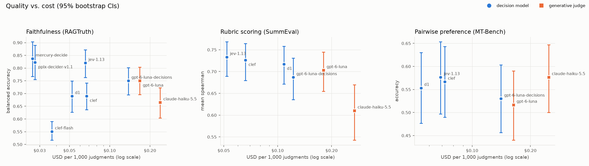
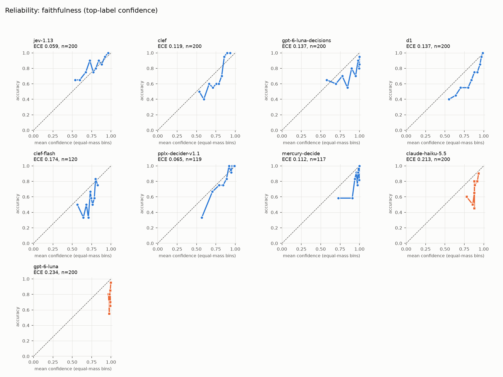
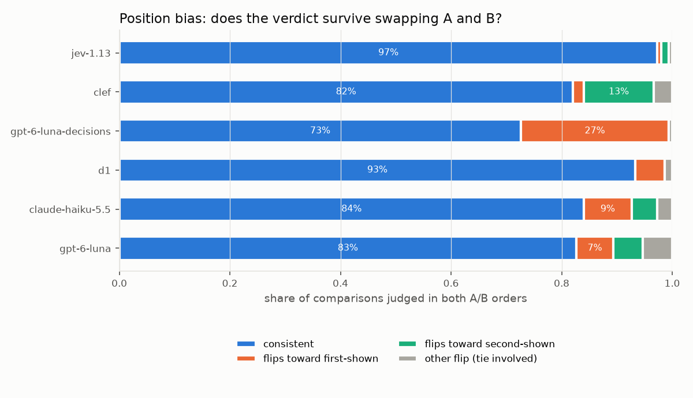
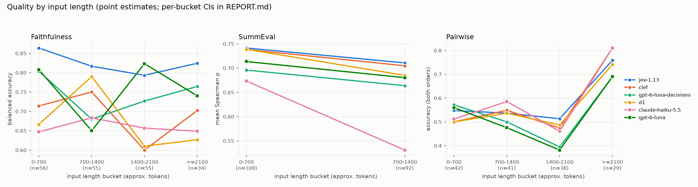

# judgment-calls: full write-up

*judgment call: a decision that requires judgment.*

**Can OpenRouter's new decision models replace generative LLM-as-a-judge?** This repo runs both
kinds of judge on the same human-labeled judge tasks, with the same task wording. It measures
agreement with human labels, calibration, consistency, cost and latency, with bootstrap
confidence intervals and paired significance tests.

## The short answer

On these three tasks the best decision models **matched or beat the two cheap generative judges I
tested** (Claude Haiku 5.5 and GPT-6 Luna, both with reasoning switched off). They did it at about
**2–4× lower cost per judgment** ($0.06–0.14 vs. $0.17–0.25 per 1,000) and **about 3× lower
latency** (p50 0.4–0.6 s vs. 1.4–1.5 s), and their confidence was **much better calibrated**. On
binary faithfulness, `typesafe/jev-1.13` reached 0.82 [0.76, 0.87] balanced accuracy against
human hallucination labels. Haiku reached 0.67 [0.60, 0.72] (significant after Holm correction)
and GPT-6 Luna 0.75 [0.70, 0.80] (not significant on accuracy, but significant on AUROC, Brier and
ECE). On rubric scoring every decision model significantly beat Haiku, and none could be told
apart from GPT-6 Luna. On **pairwise preference with ties, nothing wins**: every judge in both
families lands at 52–58% three-way accuracy, and no pairwise difference is significant. So the
answer is **yes for grounding checks and rubric scores, not proven for pairwise preference**.
A stronger, ~20× pricier reference judge (Claude Sonnet 5.5) ran on a fixed 52-item
faithfulness / 40-item SummEval subset. It **did not significantly beat any decision model**
there. It significantly beat only Haiku (faithfulness AUROC) and d1 (SummEval QWK). Its point
estimates were not higher than jev-1.13's on balanced accuracy or Spearman. With n = 40–60 the
CIs are wide (about ±0.08–0.15), so this rules out large advantages for the expensive judge, not small
ones (see [Reference judge](#reference-judge-subset)).

## Prior work: where this fits

[Jagent's Decisions API benchmark](https://jev-agent.com/decisions-api) (run on 2026-10-08)
compared 13 decision models on **classification** (BTZSC topic, intent and sentiment sets plus
hand-written tickets). It reported accuracy, wrong-at-≥90%-confidence, calibration gap, latency
and cost. It explicitly left out a head-to-head comparison with generative judges,
faithfulness/hallucination detection, rubric (score) questions, and repeated runs with
significance testing. **judgment-calls covers exactly those gaps.** It is complementary work, not
a replacement: read Jagent for breadth across decision models on classification, and this repo
for judge tasks.

## Method

| Task | Question type | Human labels | n | Headline metric |
|---|---|---|---|---|
| Faithfulness / hallucination detection | `noul` (P(hallucinated)) | RAGTruth span annotations | 200 (100/100) | balanced accuracy, AUROC |
| Rubric scoring (coherence, consistency, fluency, relevance) | 4 × `score` (1–5) | SummEval expert ratings | 200 | mean Spearman ρ (also Kendall τ, QWK, MAE) |
| Pairwise preference with explicit ties | `choice` (A / B / tie) | MT-Bench expert votes | 150 × 2 orders | 3-way accuracy, swap consistency |

[DATASETS.md](../DATASETS.md) covers licenses, how each set was labeled, sampling, and contamination.

- **One spec, two judge families.** Each task is a versioned `TaskSpec`
  ([`src/judgment_calls/tasks/`](../src/judgment_calls/tasks)). The decision-model `instructions` and
  `criteria` and the generative judge's rubric and JSON schema are both *generated* from it, so
  both families read identical wording.
- **Decision models** are called through `POST /api/v1/systemone`. Their answer probability is
  the confidence.
- **Generative judges** are called through chat completions with a strict JSON schema at
  temperature 0, with hidden reasoning disabled (`reasoning.effort = "none"`). They return the
  answer plus a **verbalized confidence** (0–100). `openai/gpt-4o-mini` was added because it
  exposes **token logprobs** (neither primary generative judge does), but it only ran in the smoke
  test (see Limitations).
- **Sampling:** a fixed seed, stratified by label, with an even spread over input-length buckets
  so long-input behaviour can be studied (Clef reads only about the first 2K tokens; Kev has an 8K
  context).
- **Statistics:** 95% percentile-bootstrap CIs over items (2,000 resamples) for every headline
  metric. Decision-vs-generative claims use a **paired bootstrap** on common items, Holm-corrected
  across all decision×generative pairs of a task and metric, plus an exact **McNemar** test on
  per-item correctness. No difference is called significant unless the Holm-adjusted p < 0.05.
- **Calibration:** ECE with 10 equal-mass bins, Brier score, reliability diagrams, and
  *wrong@≥0.9* (share of all judgments that are wrong while claiming ≥90% confidence).
- **Consistency:** 3 identical calls on 10 items per task. **Position bias:** every pairwise item
  is judged in both A/B orders.

## Results

All numbers come from the real runs logged in [`results/raw/`](../results/raw). The full report,
with every table, is [`results/REPORT.md`](../results/REPORT.md).

| judge | family | faithfulness bal. acc. | faithfulness AUROC | SummEval mean ρ | pairwise acc. (A/B/tie) | $ / 1k judgments | p50 latency |
|---|---|---|---|---|---|---|---|
| typesafe/jev-1.13 | decision | **0.820** [0.764, 0.871] | **0.881** [0.831, 0.924] | **0.733** [0.689, 0.768] | 0.577 [0.497, 0.653] | $0.063 | 0.44 s |
| cloudflare/clef | decision | 0.690 [0.637, 0.741] | 0.877 [0.829, 0.919] | 0.726 [0.680, 0.764] | 0.567 [0.490, 0.643] | $0.069 | 0.57 s |
| openai/gpt-6-luna-decisions | decision | 0.750 [0.695, 0.802] | 0.850 [0.792, 0.900] | 0.687 [0.636, 0.731] | 0.530 [0.457, 0.603] | $0.135 | 0.39 s |
| liquid/d1 | decision | 0.690 [0.627, 0.749] | 0.829 [0.768, 0.882] | 0.717 [0.671, 0.758] | 0.553 [0.477, 0.630] | $0.069 | 0.46 s |
| anthropic/claude-haiku-5.5 | generative | 0.665 [0.604, 0.723] | 0.732 [0.667, 0.796] | 0.610 [0.543, 0.670] | 0.577 [0.500, 0.647] | $0.251 | 1.51 s |
| openai/gpt-6-luna | generative | 0.750 [0.696, 0.803] | 0.800 [0.734, 0.858] | 0.703 [0.655, 0.744] | 0.517 [0.440, 0.590] | $0.169 | 1.37 s |
| *partial runs (faithfulness only, ~118 of 200 items)* | | | | | | | |
| perplexity/pplx-decider-v1.1-27b | decision | 0.822 [0.755, 0.890] | 0.932 [0.885, 0.970] | — | — | $0.030 | 0.47 s |
| inception/mercury-decide | decision | 0.837 [0.767, 0.903] | 0.902 [0.837, 0.956] | — | — | $0.027 | 0.67 s |
| cloudflare/clef-flash | decision | 0.551 [0.517, 0.590] | 0.725 [0.628, 0.813] | — | — | $0.037 | 0.48 s |

The partial runs covered a different (random, hash-ordered) subset, so compare them with the
full-sample rows only through the paired tests in the report, which use common items. Human
ceiling for pairwise: human–human agreement is 66% with ties and 83% without.



### Reference judge (subset)

`anthropic/claude-sonnet-5.5` ($2/M in, $10/M out) was run as a stronger generative reference on
a fixed, stratified subset. The item ids are in
[`data/samples/reference_subset/`](../data/samples/reference_subset), seed 20261010. Planned:
60 faithfulness items (30/30) and 40 SummEval items spread over the human-score range. The
$0.50 cap stopped the run after **52 faithfulness items (25 hallucinated / 27 not) and all 40
SummEval items**. All rows below use exactly those items, so they differ from the full-sample
table above. This endpoint rejects disabled reasoning, so Sonnet ran with
`reasoning.effort = minimal` (0 reasoning tokens billed in a probe). The other generative judges
ran with reasoning off. Its AUROC uses the verbalized confidence.

| judge | faithfulness bal. acc. (n=52) | faithfulness AUROC | SummEval mean ρ (n=40) | SummEval mean QWK |
|---|---|---|---|---|
| claude-sonnet-5.5 (reference) | 0.648 [0.562, 0.738] | 0.881 [0.784, 0.951] | 0.710 [0.574, 0.803] | 0.654 [0.510, 0.751] |
| jev-1.13 | 0.827 [0.719, 0.923] | 0.845 [0.726, 0.945] | 0.757 [0.644, 0.831] | 0.624 [0.510, 0.703] |
| clef | 0.761 [0.654, 0.859] | 0.899 [0.813, 0.969] | 0.714 [0.586, 0.803] | 0.512 [0.405, 0.600] |
| gpt-6-luna-decisions | 0.721 [0.615, 0.820] | 0.801 [0.673, 0.905] | 0.715 [0.587, 0.799] | 0.588 [0.456, 0.694] |
| d1 | 0.666 [0.547, 0.783] | 0.803 [0.677, 0.908] | 0.762 [0.646, 0.834] | 0.392 [0.286, 0.488] |
| claude-haiku-5.5 | 0.587 [0.464, 0.701] | 0.640 [0.484, 0.775] | 0.735 [0.618, 0.817] | 0.585 [0.464, 0.684] |
| gpt-6-luna | 0.738 [0.622, 0.852] | 0.786 [0.661, 0.897] | 0.718 [0.596, 0.805] | 0.643 [0.510, 0.739] |

Of the 36 Holm-corrected paired tests (Sonnet vs. each of the six judges, on balanced accuracy,
AUROC, Brier and ECE for faithfulness, and on Spearman and QWK for SummEval), only two are
significant: Sonnet beats Haiku on AUROC (+0.24 [+0.09, +0.40]) and d1 on QWK
(+0.26 [+0.14, +0.36]). Sonnet's lower balanced accuracy has a clear cause: it flags 85% of
responses as hallucinated (recall 100%, precision 57%). Its ranking is good (AUROC 0.88), but its
yes/no threshold is far too strict for this label definition. The jev-1.13 − Sonnet balanced
accuracy gap (+0.18 [+0.05, +0.30]) does not survive Holm (p = 0.06). Sonnet cost **$5.16 per
1,000 judgments**, about 80× jev-1.13. Full tables are in `results/REPORT.md`.

### Findings (stated as carefully as the CIs allow)

1. **Faithfulness: decision models rank better and are better calibrated. Accuracy gains are
   clear only against Haiku.** Every full-sample decision model has a higher AUROC than Haiku
   (all Holm p < 0.05). jev-1.13 and Clef also beat GPT-6 Luna on AUROC (+0.08, Holm p = 0.032),
   but d1 and luna-decisions do not. On balanced accuracy only jev-1.13 vs. Haiku survives Holm
   (+0.155 [+0.079, +0.230]). jev-1.13 vs. Luna is +0.070 [+0.008, +0.131], with raw p = 0.02
   but Holm p = 0.17, so **not significant**. Clef has a high AUROC (0.877) but flags only 23% of
   responses (recall 42%): its ranking is good, but its 0.5 threshold is badly placed for this
   task.
2. **Controlled comparison, the same base model with two heads.** `gpt-6-luna-decisions` and
   `gpt-6-luna` have *identical* faithfulness accuracy (0.750 each; McNemar 17 vs. 17 discordant).
   They are statistically indistinguishable on SummEval (Δρ −0.016 [−0.050, +0.015]) and on
   pairwise (+0.013 [−0.027, +0.053]). The decision head gives better-calibrated probabilities
   (faithfulness ECE −0.097 [−0.145, −0.031], Holm p = 0.036; the Brier difference is not
   significant). The decision variant also has the **strongest position bias** of any judge: 27%
   of its pairwise verdicts flip toward whichever answer is shown first.
3. **Verbalized confidence is nearly useless as a probability.** GPT-6 Luna reports ≥90%
   confidence on *every* faithfulness judgment (mean 0.98), and 25% of all its judgments are
   wrong at ≥90% confidence (39% on pairwise). For the four full-sample decision models the
   faithfulness figure is 0–9%. jev-1.13 has a lower Brier score and ECE than both generative
   judges (Holm p < 0.001).
   
4. **Rubric scoring: decision models rank summaries as well as GPT-6 Luna and better than
   Haiku**, with mean ρ 0.69–0.73 vs. 0.70 and 0.61. All four decision-vs-Haiku differences are
   significant and none of the decision-vs-Luna differences are. Ranking is not the same as being
   on the right scale, though: Clef's expected scores run 0.70 points below the experts and d1's
   0.30 above, which gives them the lowest QWK (0.45, 0.37). GPT-6 Luna has the best QWK (0.59).
   If you need absolute scores rather than rankings, calibrate the offset.
5. **Pairwise with ties is hard for every judge, and position bias varies a lot.** All judges
   predict "tie" for only 1–5% of judgments, while humans chose tie for a third of this sample.
   That is the main reason 3-way accuracy sits at 0.52–0.58. Without ties, agreement is
   0.73–0.85, which is close to the 0.83 human–human figure. Swap consistency: jev-1.13 97%
   [95, 99], d1 93%, Haiku 84%, Luna 83%, Clef 82% (it leans to the *second* answer),
   luna-decisions 73%.
   

Length: there is no clear degradation on long faithfulness inputs for any judge, including Clef
on inputs of ≥2,100 tokens (0.70 [0.53, 0.88]). The response was placed *before* the source, so
truncation removed the end of the source, not the response. That is not evidence that Clef reads
long inputs. Per-bucket CIs are wide (n = 34). On pairwise, the ≥2,100 bucket looks easier for
everyone only because it holds fewer human ties (17% vs. 33%).


Consistency (3 calls, 10 items per task, descriptive only): Clef and luna-decisions returned
identical probabilities every time. jev-1.13 and d1 varied slightly (one or two label flips out
of 70 answers each). The generative judges flipped labels on 10–20% of answers even at
temperature 0.

## When to use which

- **Grounding / hallucination gates (yes/no):** use a decision model. jev-1.13 is the best
  full-sample result here, and pplx-decider and mercury-decide looked as strong on a partial
  sample (confirm before relying on that). You get a usable probability, so tune the threshold
  on your own labeled data rather than using 0.5. Clef in particular needs a lower threshold.
- **Rubric scores where ranking matters (triage, regression tests, A/B of prompts):** a decision
  model is as good as GPT-6 Luna and cheaper. If you need the absolute 1–5 value, check the
  scale offset first.
- **Pairwise preference:** neither family is clearly better. If you use a decision model,
  **always judge both orders** and aggregate, prefer jev-1.13 or d1 (most order-stable), and
  avoid luna-decisions for this task. Expect ties to be under-predicted by every judge.
- **When you need an explanation or multi-step reasoning:** decision models give no rationale.
  Reasoning-enabled or stronger generative judges were not tested here.

## Limitations

- **Budget and credits.** The hard cap was $8, but the API key had a **$1 credit limit** and was
  also being used by another process during the run. Spend recorded by this harness was
  **$0.62** for the main runs (plus about $0.001 of untracked manual probes), and **$0.48** for
  the reference-judge follow-up after the key's limit was raised. Because of that:
  - the **stronger reference judge** (Claude Sonnet 5.5) ran only on a 52 + 40 item subset, with
    a separate $0.50 cap. Its CIs are about 1.5–2× as wide as the main results, and it ran with
    minimal reasoning while the other generative judges ran with none;
  - **gpt-4o-mini (logprobs)** ran only on the 5-item smoke test, so the planned *verbalized vs.
    logprob vs. decision-probability* calibration comparison is **not reported**. The extraction
    code is implemented and tested with recorded fixtures;
  - **solar-decide-flash, tev1-4b and kev-4b** ran only on the smoke test (n = 5), so no results
    are reported for them. clef-flash, pplx-decider and mercury-decide ran on faithfulness only
    and stopped at about 118/200 items when the key hit its limit;
  - pairwise was reduced from 200 to 150 items, and repeats were cut to 10 items per task.
- **The main generative judges were small, non-reasoning models with no chain-of-thought.** The
  larger reference judge was checked only on a subset and not on pairwise. A judge with full
  reasoning could still change the conclusion, especially on pairwise.
- **Contamination:** all datasets are public, and any model may have seen them (see
  DATASETS.md). No fresh author-written set was built.
- **Tokens are approximate** (characters ÷ 4) for the length buckets. Billed tokens are logged
  per call.
- **Single run date and region.** Model versions as served are logged per record (e.g.
  `typesafe/jev-1.13-20260917`, `openai/gpt-6-luna-decisions-20261006`). Latency was measured
  from one machine with up to 32 concurrent requests.
- Clef's billed price was about $0.05/M input tokens in these runs, not the listed $0.24/M. Costs
  in this repo are always the billed `usage.cost`.

## Reproduce

```bash
uv sync
export OPENROUTER_API_KEY=...            # or copy .env.example to .env and export it; never commit it
uv run judgment-calls prepare            # downloads datasets, rebuilds data/samples (identical with the default seed)
uv run judgment-calls run --limit 5 --judges all-decision all-generative --budget 0.5   # smoke test
uv run judgment-calls run --judges primary --budget 8                                  # main run
uv run judgment-calls run --judges primary --repeats 3 --repeat-limit 10 --budget 8    # consistency
uv run judgment-calls subset             # fixed reference subset id lists (already committed)
uv run judgment-calls run --tasks faithfulness summeval --judges claude-sonnet-5.5 \
    --subset-dir data/samples/reference_subset --budget 8                             # reference judge
uv run judgment-calls report             # results/REPORT.md, results/summary.json, results/charts/*.png
```

The prepared pairwise sample in this repo was built with `prepare --tasks pairwise --n 150`.

- Results are appended to `results/raw/<task>.jsonl`, one line per judgment, with full
  provenance: the model id requested and served, provider, timestamp, spec version and hash,
  request hash, cost, tokens, latency, parsed answers and the raw response.
- A content-hash cache (`.cache/responses.sqlite`) means re-runs never pay twice. Completed
  judgments are skipped.
- The spend ledger (`results/spend_ledger.jsonl`) enforces `--budget` across all runs. Each call
  reserves a worst-case estimate before it is sent, and the run stops cleanly at the cap or when
  the key reports that its credits are exhausted.
- `uv run judgment-calls run --dry-run` estimates the worst-case cost without calling anything.

Development: `uv run ruff check src tests && uv run ruff format --check src tests && uv run pyright && uv run pytest`.
The tests use recorded fixtures and block all network access. CI runs the same steps and never
calls an API.

## Add a model

Add one line to [`src/judgment_calls/judges.py`](../src/judgment_calls/judges.py):

```python
JudgeConfig(id="my-decider", kind="decision", model="vendor/model-id", price_in_per_m=0.05)
# or a generative judge (set logprobs=True if the provider returns them):
JudgeConfig(id="my-judge", kind="generative", model="vendor/model", price_in_per_m=0.3,
            price_out_per_m=1.2, extra_body={"reasoning": {"effort": "none"}})
```

Then run `uv run judgment-calls run --judges my-decider` and `uv run judgment-calls report`.
The prices are only used to reserve budget before each call; reported costs come from
`usage.cost`. To add a task, write a new `TaskSpec` plus a loader that yields `Item`s. Both judge
families pick it up automatically.

## Citation

If you use this, please also cite the complementary classification benchmark:

- Jagent, *Decisions API benchmark: 13 decision models on classification*,
  <https://jev-agent.com/decisions-api>, run 2026-10-08.
- judgment-calls, Onur Ceri, 2026, <https://github.com/onurceri/judgment-calls> (MIT).

Datasets: RAGTruth (Niu et al., 2024), SummEval (Fabbri et al., 2021), and MT-Bench human
judgments (Zheng et al., 2023).
