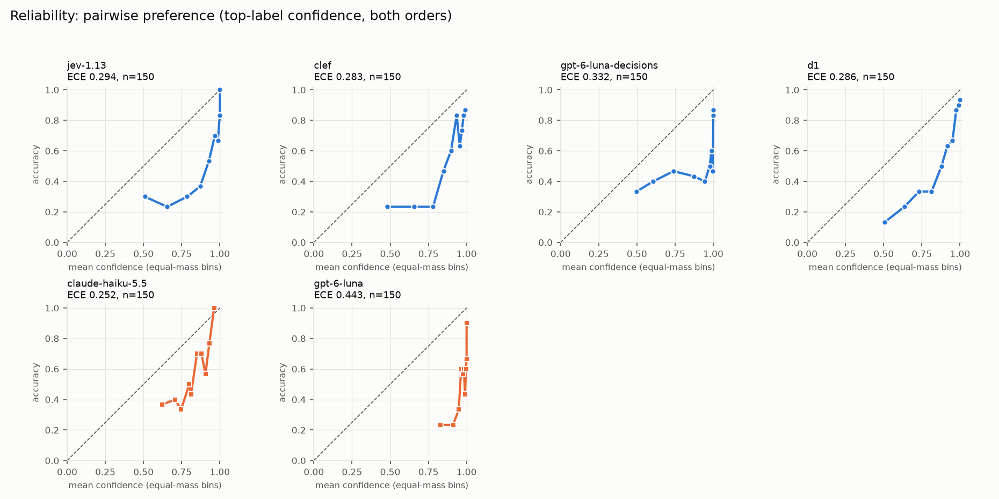

# judgment-calls: results report

Generated 2026-10-10 08:06 UTC by `judgment-calls report` from `results/raw/*.jsonl`. Total API spend recorded in the ledger: **$1.1019**. All intervals are 95% percentile-bootstrap CIs over items (2,000 resamples). Headline metrics use repeat 0 of every item.

¹ = judge covered only part of the sample (the run hit the API key's credit limit); its numbers are on the items it did judge and are **not** directly comparable to full-sample judges except in the paired comparisons, which always use common items.

## Coverage

| judge | faithfulness | summeval | pairwise |
|---|---|---|---|
| jev-1.13 | 200/200 | 200/200 | 150/150 |
| clef | 200/200 | 200/200 | 150/150 |
| gpt-6-luna-decisions | 200/200 | 200/200 | 150/150 |
| d1 | 200/200 | 200/200 | 150/150 |
| clef-flash | 120/200 | 5/200 | 5/150 |
| solar-decide-flash | 5/200 | 5/200 | 5/150 |
| pplx-decider-v1.1 | 119/200 | 5/200 | 5/150 |
| mercury-decide | 117/200 | 5/200 | 5/150 |
| tev1-4b | 5/200 | 5/200 | 5/150 |
| kev-4b | 5/200 | 5/200 | 5/150 |
| claude-haiku-5.5 | 200/200 | 200/200 | 150/150 |
| gpt-6-luna | 200/200 | 200/200 | 150/150 |
| gpt-4o-mini | 5/200 | 5/200 | 5/150 |
| claude-sonnet-5.5 | 52/200 | 40/200 | 0/150 |

- faithfulness: smoke-test only, excluded from analysis: solar-decide-flash (n=5), tev1-4b (n=5), kev-4b (n=5), gpt-4o-mini (logprob) (n=5), gpt-4o-mini (n=5)
- summeval: smoke-test only, excluded from analysis: clef-flash (n=5), solar-decide-flash (n=5), pplx-decider-v1.1 (n=5), mercury-decide (n=5), tev1-4b (n=5), kev-4b (n=5), gpt-4o-mini (logprob) (n=5), gpt-4o-mini (n=5)
- pairwise: smoke-test only, excluded from analysis: clef-flash (n=5), solar-decide-flash (n=5), pplx-decider-v1.1 (n=5), mercury-decide (n=5), tev1-4b (n=5), kev-4b (n=5), gpt-4o-mini (logprob) (n=5), gpt-4o-mini (n=5)

## Headline

| judge | family | faithfulness bal. acc. | faithfulness AUROC | SummEval mean ρ | pairwise acc. (A/B/tie) | $/1k judgments | p50 latency |
|---|---|---|---|---|---|---|---|
| jev-1.13 | decision | 0.820 [0.764, 0.871] | 0.881 [0.831, 0.924] | 0.733 [0.689, 0.768] | 0.577 [0.497, 0.653] | $0.063 | 0.44s |
| clef | decision | 0.690 [0.637, 0.741] | 0.877 [0.829, 0.919] | 0.726 [0.680, 0.764] | 0.567 [0.490, 0.643] | $0.069 | 0.57s |
| gpt-6-luna-decisions | decision | 0.750 [0.695, 0.802] | 0.850 [0.792, 0.900] | 0.687 [0.636, 0.731] | 0.530 [0.457, 0.603] | $0.135 | 0.39s |
| d1 | decision | 0.690 [0.627, 0.749] | 0.829 [0.768, 0.882] | 0.717 [0.671, 0.758] | 0.553 [0.477, 0.630] | $0.069 | 0.46s |
| clef-flash ¹ | decision | 0.551 [0.517, 0.590] | 0.725 [0.628, 0.813] | — | — | $0.037 | 0.48s |
| pplx-decider-v1.1 ¹ | decision | 0.822 [0.755, 0.890] | 0.932 [0.885, 0.970] | — | — | $0.030 | 0.47s |
| mercury-decide ¹ | decision | 0.837 [0.767, 0.903] | 0.902 [0.837, 0.956] | — | — | $0.027 | 0.67s |
| claude-haiku-5.5 | generative | 0.665 [0.604, 0.723] | 0.732 [0.667, 0.796] | 0.610 [0.543, 0.670] | 0.577 [0.500, 0.647] | $0.251 | 1.51s |
| gpt-6-luna | generative | 0.750 [0.696, 0.803] | 0.800 [0.734, 0.858] | 0.703 [0.655, 0.744] | 0.517 [0.440, 0.590] | $0.169 | 1.37s |

## Task 1: faithfulness / hallucination detection (RAGTruth, `noul`)

Sample: 200 responses, labels {'False': 100, 'True': 100}, length buckets {'0-700': 56, '1400-2100': 55, '700-1400': 55, '>=2100': 34}. Positive class = hallucinated.

| judge | n | accuracy | balanced acc. | macro-F1 | Cohen κ | AUROC | flagged | recall | precision |
|---|---|---|---|---|---|---|---|---|---|
| jev-1.13 | 200 | 0.820 [0.765, 0.870] | 0.820 [0.764, 0.871] | 0.820 [0.763, 0.870] | 0.640 [0.527, 0.740] | 0.881 [0.831, 0.924] | 51% | 83% | 81% |
| clef | 200 | 0.690 [0.625, 0.755] | 0.690 [0.637, 0.741] | 0.666 [0.598, 0.732] | 0.380 [0.272, 0.490] | 0.877 [0.829, 0.919] | 23% | 42% | 91% |
| gpt-6-luna-decisions | 200 | 0.750 [0.685, 0.810] | 0.750 [0.695, 0.802] | 0.738 [0.670, 0.799] | 0.500 [0.385, 0.609] | 0.850 [0.792, 0.900] | 71% | 96% | 68% |
| d1 | 200 | 0.690 [0.625, 0.755] | 0.690 [0.627, 0.749] | 0.681 [0.612, 0.745] | 0.380 [0.255, 0.502] | 0.829 [0.768, 0.882] | 33% | 52% | 79% |
| clef-flash ¹ | 120 | 0.558 [0.467, 0.650] | 0.551 [0.517, 0.590] | 0.441 [0.364, 0.522] | 0.103 [0.033, 0.189] | 0.725 [0.628, 0.813] | 5% | 10% | 100% |
| pplx-decider-v1.1 ¹ | 119 | 0.824 [0.756, 0.891] | 0.822 [0.755, 0.890] | 0.822 [0.753, 0.890] | 0.646 [0.510, 0.780] | 0.932 [0.885, 0.970] | 43% | 76% | 86% |
| mercury-decide ¹ | 117 | 0.838 [0.769, 0.906] | 0.837 [0.767, 0.903] | 0.837 [0.767, 0.904] | 0.675 [0.534, 0.808] | 0.902 [0.837, 0.956] | 48% | 82% | 84% |
| claude-haiku-5.5 | 200 | 0.665 [0.595, 0.730] | 0.665 [0.604, 0.723] | 0.653 [0.585, 0.719] | 0.330 [0.206, 0.449] | 0.732 [0.667, 0.796] | 68% | 85% | 62% |
| gpt-6-luna | 200 | 0.750 [0.690, 0.810] | 0.750 [0.696, 0.803] | 0.741 [0.676, 0.802] | 0.500 [0.387, 0.612] | 0.800 [0.734, 0.858] | 69% | 94% | 68% |

Accuracy by RAGTruth sub-task:

| judge | Data2txt | QA | Summary |
|---|---|---|---|
| jev-1.13 | 0.85 [0.76, 0.95] | 0.84 [0.72, 0.93] | 0.79 [0.72, 0.86] |
| clef | 0.60 [0.47, 0.71] | 0.81 [0.70, 0.93] | 0.69 [0.59, 0.77] |
| gpt-6-luna-decisions | 0.78 [0.67, 0.89] | 0.72 [0.58, 0.86] | 0.75 [0.66, 0.82] |
| d1 | 0.76 [0.65, 0.87] | 0.77 [0.63, 0.88] | 0.62 [0.52, 0.71] |
| clef-flash ¹ | 0.43 [0.29, 0.60] | 0.56 [0.37, 0.74] | 0.64 [0.52, 0.76] |
| pplx-decider-v1.1 ¹ | 0.86 [0.74, 0.97] | 0.92 [0.81, 1.00] | 0.76 [0.66, 0.86] |
| mercury-decide ¹ | 0.80 [0.66, 0.91] | 0.85 [0.69, 0.96] | 0.86 [0.75, 0.95] |
| claude-haiku-5.5 | 0.73 [0.62, 0.84] | 0.67 [0.53, 0.79] | 0.63 [0.53, 0.72] |
| gpt-6-luna | 0.80 [0.69, 0.89] | 0.72 [0.58, 0.86] | 0.74 [0.65, 0.81] |

## Calibration

Top-label confidence vs. correctness. Decision models: the model's probability for its answer. Generative judges: verbalized confidence (0–100 → 0–1), or the token probability of the answer for `(logprob)` rows. ECE uses 10 equal-mass bins. Brier: faithfulness uses P(hallucinated) vs. the label; pairwise uses top-label confidence vs. correctness. *wrong@≥0.9* = share of all judgments that are wrong while claiming ≥90% confidence. Note: ECE is biased upward under resampling, so its bootstrap interval can sit mostly above the point estimate; use it as a rough guide and prefer the paired Brier/ECE comparisons below.

| task | judge | n | mean conf. | ECE | Brier | wrong@≥0.9 | error rate when ≥0.9 |
|---|---|---|---|---|---|---|---|
| faithfulness | jev-1.13 | 200 | 0.772 | 0.059 [0.053, 0.125] | 0.140 [0.114, 0.168] | 0% | 2% of 40 |
| faithfulness | clef | 200 | 0.756 | 0.119 [0.083, 0.181] | 0.188 [0.159, 0.217] | 0% | 0% of 25 |
| faithfulness | gpt-6-luna-decisions | 200 | 0.872 | 0.137 [0.094, 0.204] | 0.198 [0.155, 0.245] | 9% | 16% of 110 |
| faithfulness | d1 | 200 | 0.824 | 0.137 [0.090, 0.200] | 0.200 [0.163, 0.242] | 4% | 10% of 78 |
| faithfulness | clef-flash ¹ | 120 | 0.726 | 0.174 [0.130, 0.276] | 0.265 [0.225, 0.306] | 0% | n/a of 0 |
| faithfulness | pplx-decider-v1.1 ¹ | 119 | 0.858 | 0.065 [0.051, 0.141] | 0.112 [0.076, 0.152] | 2% | 3% of 63 |
| faithfulness | mercury-decide ¹ | 117 | 0.946 | 0.112 [0.063, 0.181] | 0.133 [0.081, 0.192] | 11% | 13% of 101 |
| faithfulness | claude-haiku-5.5 | 200 | 0.878 | 0.213 [0.154, 0.283] | 0.263 [0.214, 0.313] | 3% | 13% of 46 |
| faithfulness | gpt-6-luna | 200 | 0.984 | 0.234 [0.175, 0.295] | 0.242 [0.184, 0.300] | 25% | 25% of 200 |
| pairwise | jev-1.13 | 150 | 0.870 | 0.294 [0.241, 0.343] | 0.288 [0.246, 0.328] | 15% | 25% of 183 |
| pairwise | clef | 150 | 0.849 | 0.283 [0.234, 0.331] | 0.282 [0.244, 0.321] | 12% | 22% of 164 |
| pairwise | gpt-6-luna-decisions | 150 | 0.862 | 0.332 [0.277, 0.387] | 0.353 [0.307, 0.396] | 25% | 40% of 188 |
| pairwise | d1 | 150 | 0.840 | 0.286 [0.236, 0.335] | 0.273 [0.234, 0.310] | 11% | 21% of 152 |
| pairwise | claude-haiku-5.5 | 150 | 0.822 | 0.252 [0.192, 0.297] | 0.283 [0.248, 0.318] | 7% | 24% of 84 |
| pairwise | gpt-6-luna | 150 | 0.960 | 0.443 [0.386, 0.499] | 0.435 [0.382, 0.487] | 39% | 44% of 262 |

## Task 2: rubric scoring (SummEval, `score`)

Sample: 200 summaries (stratified by the rounded mean expert rating: {'0': 6, '1': 43, '2': 51, '3': 50, '4': 50} on the 0–4 index scale). One call per summary answers all four dimensions. Decision models: expected score Σ i·p(i); generative judges: the integer they output (or the logprob expectation). Correlations are pooled over summaries (summary-level), not averaged per document.

| judge | n | mean Spearman ρ | mean Kendall τ | mean QWK | mean MAE | mean bias (judge − human) |
|---|---|---|---|---|---|---|
| jev-1.13 | 200 | 0.733 [0.689, 0.768] | 0.559 [0.521, 0.595] | 0.575 [0.527, 0.616] | 0.860 [0.815, 0.906] | -0.31 |
| clef | 200 | 0.726 [0.680, 0.764] | 0.553 [0.513, 0.591] | 0.452 [0.407, 0.491] | 0.984 [0.927, 1.041] | -0.70 |
| gpt-6-luna-decisions | 200 | 0.687 [0.636, 0.731] | 0.521 [0.479, 0.563] | 0.547 [0.496, 0.597] | 0.931 [0.871, 0.990] | -0.31 |
| d1 | 200 | 0.717 [0.671, 0.758] | 0.543 [0.503, 0.583] | 0.368 [0.317, 0.417] | 0.917 [0.866, 0.968] | 0.30 |
| claude-haiku-5.5 | 200 | 0.610 [0.543, 0.670] | 0.519 [0.461, 0.571] | 0.487 [0.425, 0.545] | 0.917 [0.854, 0.980] | -0.52 |
| gpt-6-luna | 200 | 0.703 [0.655, 0.744] | 0.591 [0.549, 0.630] | 0.591 [0.540, 0.637] | 0.867 [0.815, 0.922] | -0.31 |

Spearman ρ per dimension:

| judge | coherence | consistency | fluency | relevance |
|---|---|---|---|---|
| jev-1.13 | 0.72 [0.64, 0.78] | 0.74 [0.67, 0.79] | 0.77 [0.70, 0.82] | 0.71 [0.65, 0.77] |
| clef | 0.74 [0.67, 0.80] | 0.80 [0.75, 0.84] | 0.61 [0.50, 0.70] | 0.75 [0.69, 0.80] |
| gpt-6-luna-decisions | 0.68 [0.59, 0.75] | 0.73 [0.66, 0.78] | 0.65 [0.55, 0.73] | 0.69 [0.62, 0.75] |
| d1 | 0.70 [0.62, 0.76] | 0.76 [0.69, 0.81] | 0.72 [0.64, 0.79] | 0.69 [0.63, 0.75] |
| claude-haiku-5.5 | 0.62 [0.52, 0.71] | 0.64 [0.55, 0.72] | 0.61 [0.51, 0.69] | 0.56 [0.46, 0.66] |
| gpt-6-luna | 0.65 [0.56, 0.72] | 0.78 [0.71, 0.84] | 0.72 [0.64, 0.78] | 0.66 [0.59, 0.73] |

## Task 3: pairwise preference (MT-Bench human judgments, `choice`)

Sample: 150 comparisons (labels {'A': 50, 'B': 50, 'tie': 50}), each judged in both A/B orders. Human–human agreement on multiply-annotated comparisons in the full dataset: **66% with ties** (2368 vote pairs) and **83% without ties** (1550 pairs), a practical ceiling.

| judge | n | accuracy (3-way) | agreement w/o ties | macro-F1 | κ | predicts tie | A/B-swap consistency | flips → first | flips → second | P(first | non-tie) |
|---|---|---|---|---|---|---|---|---|---|---|
| jev-1.13 | 150 | 0.577 [0.497, 0.653] | 0.840 [0.765, 0.910] | 0.487 [0.423, 0.548] | 0.365 [0.269, 0.458] | 2% | 0.973 [0.947, 0.993] | 1% | 1% | 0.49 |
| clef | 150 | 0.567 [0.490, 0.643] | 0.852 [0.786, 0.913] | 0.472 [0.418, 0.527] | 0.350 [0.262, 0.442] | 2% | 0.820 [0.753, 0.873] | 2% | 13% | 0.44 |
| gpt-6-luna-decisions | 150 | 0.530 [0.457, 0.603] | 0.760 [0.689, 0.832] | 0.456 [0.389, 0.520] | 0.295 [0.209, 0.386] | 2% | 0.727 [0.653, 0.793] | 27% | 0% | 0.63 |
| d1 | 150 | 0.553 [0.477, 0.630] | 0.829 [0.758, 0.899] | 0.450 [0.398, 0.498] | 0.330 [0.242, 0.425] | 1% | 0.933 [0.893, 0.967] | 5% | 0% | 0.53 |
| claude-haiku-5.5 | 150 | 0.577 [0.500, 0.647] | 0.843 [0.777, 0.906] | 0.492 [0.430, 0.551] | 0.365 [0.275, 0.452] | 3% | 0.840 [0.780, 0.900] | 9% | 5% | 0.52 |
| gpt-6-luna | 150 | 0.517 [0.440, 0.590] | 0.730 [0.641, 0.814] | 0.464 [0.393, 0.533] | 0.275 [0.177, 0.373] | 5% | 0.827 [0.760, 0.887] | 7% | 5% | 0.51 |

Accuracy by turn:

| judge | turn 1 | turn 2 |
|---|---|---|
| jev-1.13 | 0.51 [0.37, 0.65] | 0.61 [0.51, 0.70] |
| clef | 0.49 [0.36, 0.62] | 0.60 [0.51, 0.70] |
| gpt-6-luna-decisions | 0.54 [0.41, 0.66] | 0.52 [0.43, 0.61] |
| d1 | 0.49 [0.36, 0.63] | 0.58 [0.49, 0.68] |
| claude-haiku-5.5 | 0.53 [0.40, 0.66] | 0.60 [0.50, 0.69] |
| gpt-6-luna | 0.50 [0.37, 0.63] | 0.52 [0.43, 0.62] |

## Input length

Approximate tokens = characters / 4 over all state fields. Samples were stratified to over-represent long inputs. Per-bucket n is small; read the CIs.

**faithfulness** (balanced accuracy):

| judge | 0-700 | 700-1400 | 1400-2100 | >=2100 |
|---|---|---|---|---|
| jev-1.13 | 0.86 [0.77, 0.95] (n=56) | 0.82 [0.71, 0.92] (n=55) | 0.79 [0.69, 0.89] (n=55) | 0.82 [0.67, 0.94] (n=34) |
| clef | 0.71 [0.60, 0.82] (n=56) | 0.75 [0.66, 0.83] (n=55) | 0.60 [0.54, 0.68] (n=55) | 0.70 [0.53, 0.88] (n=34) |
| gpt-6-luna-decisions | 0.80 [0.71, 0.90] (n=56) | 0.68 [0.58, 0.78] (n=55) | 0.73 [0.62, 0.84] (n=55) | 0.76 [0.62, 0.89] (n=34) |
| d1 | 0.67 [0.54, 0.79] (n=56) | 0.79 [0.68, 0.89] (n=55) | 0.61 [0.51, 0.71] (n=55) | 0.63 [0.46, 0.80] (n=34) |
| clef-flash ¹ | 0.58 [0.50, 0.67] (n=33) | 0.53 [0.50, 0.61] (n=30) | 0.56 [0.50, 0.65] (n=33) | 0.50 [0.50, 0.50] (n=24) |
| pplx-decider-v1.1 ¹ | 0.87 [0.75, 0.98] (n=32) | 0.83 [0.69, 0.96] (n=30) | 0.76 [0.63, 0.89] (n=33) | 0.81 [0.63, 0.97] (n=24) |
| mercury-decide ¹ | 0.80 [0.65, 0.93] (n=31) | 0.80 [0.64, 0.93] (n=30) | 0.82 [0.68, 0.94] (n=33) | 0.97 [0.89, 1.00] (n=23) |
| claude-haiku-5.5 | 0.65 [0.53, 0.77] (n=56) | 0.68 [0.58, 0.79] (n=55) | 0.66 [0.53, 0.77] (n=55) | 0.65 [0.46, 0.81] (n=34) |
| gpt-6-luna | 0.81 [0.70, 0.91] (n=56) | 0.65 [0.54, 0.77] (n=55) | 0.82 [0.72, 0.91] (n=55) | 0.74 [0.65, 0.83] (n=34) |

**summeval** (mean Spearman ρ):

| judge | 0-700 | 700-1400 |
|---|---|---|
| jev-1.13 | 0.74 [0.68, 0.79] (n=108) | 0.71 [0.64, 0.76] (n=92) |
| clef | 0.74 [0.67, 0.79] (n=108) | 0.70 [0.63, 0.76] (n=92) |
| gpt-6-luna-decisions | 0.70 [0.62, 0.75] (n=108) | 0.66 [0.58, 0.73] (n=92) |
| d1 | 0.74 [0.67, 0.79] (n=108) | 0.68 [0.61, 0.74] (n=92) |
| claude-haiku-5.5 | 0.67 [0.59, 0.74] (n=108) | 0.53 [0.41, 0.63] (n=92) |
| gpt-6-luna | 0.71 [0.64, 0.76] (n=108) | 0.68 [0.60, 0.75] (n=92) |

**pairwise** (accuracy):

| judge | 0-700 | 700-1400 | 1400-2100 | >=2100 |
|---|---|---|---|---|
| jev-1.13 | 0.55 [0.39, 0.69] (n=42) | 0.54 [0.39, 0.68] (n=41) | 0.51 [0.36, 0.66] (n=38) | 0.76 [0.59, 0.90] (n=29) |
| clef | 0.50 [0.36, 0.63] (n=42) | 0.55 [0.40, 0.70] (n=41) | 0.47 [0.32, 0.62] (n=38) | 0.81 [0.66, 0.93] (n=29) |
| gpt-6-luna-decisions | 0.57 [0.44, 0.70] (n=42) | 0.50 [0.35, 0.65] (n=41) | 0.39 [0.26, 0.54] (n=38) | 0.69 [0.53, 0.83] (n=29) |
| d1 | 0.50 [0.36, 0.64] (n=42) | 0.54 [0.39, 0.68] (n=41) | 0.49 [0.33, 0.63] (n=38) | 0.74 [0.59, 0.88] (n=29) |
| claude-haiku-5.5 | 0.51 [0.37, 0.65] (n=42) | 0.59 [0.44, 0.73] (n=41) | 0.46 [0.30, 0.61] (n=38) | 0.81 [0.66, 0.93] (n=29) |
| gpt-6-luna | 0.56 [0.42, 0.70] (n=42) | 0.48 [0.34, 0.62] (n=41) | 0.38 [0.24, 0.54] (n=38) | 0.69 [0.52, 0.84] (n=29) |

Caveat for pairwise: the buckets differ in label mix, and judges rarely predict *tie*, so buckets with fewer human ties look easier. Human-tie share per bucket: 0-700: 38% (n=42), 700-1400: 37% (n=41), 1400-2100: 37% (n=38), >=2100: 17% (n=29). Movements shared by every judge are therefore item-mix effects, not length effects.

## Consistency across repeats

Three identical calls (temperature 0 for generative judges) on the first 10 hash-ordered items of each task (pairwise: both orders). *flip rate* = share of answers whose label is not identical across the 3 calls; *mean std* = standard deviation across calls of the probability of the first answer's label (decision models), of the verbalized confidence (generative), or of the expected score (SummEval).

| judge | task | groups | answers | flip rate | mean std |
|---|---|---|---|---|---|
| jev-1.13 | faithfulness | 10 | 10 | 10% | 0.0216 |
| clef | faithfulness | 10 | 10 | 0% | 0.0001 |
| gpt-6-luna-decisions | faithfulness | 10 | 10 | 0% | 0.0000 |
| d1 | faithfulness | 10 | 10 | 0% | 0.0016 |
| claude-haiku-5.5 | faithfulness | 10 | 10 | 10% | 0.0071 |
| gpt-6-luna | faithfulness | 10 | 10 | 10% | 0.0050 |
| jev-1.13 | summeval | 10 | 40 | 2% | 0.0356 |
| clef | summeval | 10 | 40 | 0% | 0.0000 |
| gpt-6-luna-decisions | summeval | 10 | 40 | 0% | 0.0000 |
| d1 | summeval | 10 | 40 | 5% | 0.0104 |
| claude-haiku-5.5 | summeval | 10 | 40 | 20% | 0.0943 |
| gpt-6-luna | summeval | 10 | 40 | 12% | 0.0589 |
| jev-1.13 | pairwise | 20 | 20 | 0% | 0.0064 |
| clef | pairwise | 20 | 20 | 0% | 0.0000 |
| gpt-6-luna-decisions | pairwise | 20 | 20 | 0% | 0.0000 |
| d1 | pairwise | 20 | 20 | 0% | 0.0057 |
| claude-haiku-5.5 | pairwise | 20 | 20 | 10% | 0.0157 |
| gpt-6-luna | pairwise | 20 | 20 | 20% | 0.0071 |

## Cost and latency

Cost is the sum of `usage.cost` reported by OpenRouter per call. A *judgment* is one API call (SummEval: one call answers 4 rubric questions; pairwise: each order is one call). Latency is wall-clock per successful call from this machine (Europe), with up to 32 concurrent requests.

| judge | calls | total $ | $/1k (all) | $/1k faithfulness | $/1k summeval | $/1k pairwise | mean input tokens | p50 | p95 |
|---|---|---|---|---|---|---|---|---|---|
| jev-1.13 | 780 | $0.0493 | $0.063 | $0.066 | $0.052 | $0.069 | 1505 | 0.44s | 0.62s |
| clef | 780 | $0.0539 | $0.069 | $0.067 | $0.066 | $0.072 | 1379 | 0.57s | 1.46s |
| gpt-6-luna-decisions | 780 | $0.1051 | $0.135 | $0.138 | $0.122 | $0.141 | 1348 | 0.39s | 0.75s |
| d1 | 780 | $0.0538 | $0.069 | $0.052 | $0.108 | $0.055 | 1726 | 0.46s | 0.79s |
| clef-flash | 135 | $0.0050 | $0.037 | $0.037 | $0.028 | $0.039 | 1448 | 0.48s | 0.71s |
| solar-decide-flash | 20 | $0.0025 | $0.126 | $0.088 | $0.204 | $0.105 | 2510 | 1.59s | 2.68s |
| pplx-decider-v1.1 | 134 | $0.0040 | $0.030 | $0.028 | $0.061 | $0.036 | 1479 | 0.47s | 0.66s |
| mercury-decide | 132 | $0.0035 | $0.027 | $0.027 | $0.015 | $0.035 | 1338 | 0.67s | 1.28s |
| tev1-4b | 20 | $0.0017 | $0.087 | $0.061 | $0.133 | $0.076 | 2060 | 0.41s | 0.54s |
| kev-4b | 20 | $0.0012 | $0.060 | $0.058 | $0.038 | $0.072 | 1432 | 0.77s | 1.30s |
| claude-haiku-5.5 | 780 | $0.1960 | $0.251 | $0.238 | $0.268 | $0.249 | 2325 | 1.51s | 1.98s |
| gpt-6-luna | 780 | $0.1321 | $0.169 | $0.167 | $0.180 | $0.164 | 1394 | 1.37s | 2.19s |
| gpt-4o-mini | 20 | $0.0051 | $0.257 | $0.236 | $0.236 | $0.277 | 1621 | 1.70s | 2.14s |
| claude-sonnet-5.5 | 92 | $0.4750 | $5.163 | $5.075 | $5.277 | — | 2301 | 1.72s | 2.39s |

## Paired comparisons: decision model vs. generative judge

Difference = decision − generative on the items both judged, with a paired bootstrap 95% CI and two-sided bootstrap p; Holm-adjusted across all decision×generative pairs of a task and metric. McNemar (exact) on per-item correctness is shown for binary/one-order correctness (pairwise: original order only). A difference is called significant only if Holm p < 0.05.

| task | metric | decision | generative | n | Δ [95% CI] | p | p (Holm) | significant | McNemar dec-only/gen-only |
|---|---|---|---|---|---|---|---|---|---|
| faithfulness | balanced_accuracy | jev-1.13 | claude-haiku-5.5 | 200 | +0.155 [+0.079, +0.230] | <0.001 | <0.001 | **yes** | 50/19, p=<0.001 |
| faithfulness | auroc | jev-1.13 | claude-haiku-5.5 | 200 | +0.148 [+0.078, +0.218] | <0.001 | <0.001 | **yes** | — |
| faithfulness | brier (lower=better) | jev-1.13 | claude-haiku-5.5 | 200 | -0.123 [-0.173, -0.072] | <0.001 | <0.001 | **yes** | — |
| faithfulness | ece (lower=better) | jev-1.13 | claude-haiku-5.5 | 200 | -0.154 [-0.197, -0.064] | <0.001 | <0.001 | **yes** | — |
| faithfulness | balanced_accuracy | jev-1.13 | gpt-6-luna | 200 | +0.070 [+0.008, +0.131] | 0.021 | 0.168 | no | 30/16, p=0.054 |
| faithfulness | auroc | jev-1.13 | gpt-6-luna | 200 | +0.081 [+0.025, +0.139] | 0.004 | 0.032 | **yes** | — |
| faithfulness | brier (lower=better) | jev-1.13 | gpt-6-luna | 200 | -0.102 [-0.154, -0.051] | <0.001 | <0.001 | **yes** | — |
| faithfulness | ece (lower=better) | jev-1.13 | gpt-6-luna | 200 | -0.175 [-0.216, -0.081] | <0.001 | <0.001 | **yes** | — |
| faithfulness | balanced_accuracy | clef | claude-haiku-5.5 | 200 | +0.025 [-0.051, +0.103] | 0.481 | 1.000 | no | 53/48, p=0.691 |
| faithfulness | auroc | clef | claude-haiku-5.5 | 200 | +0.145 [+0.076, +0.213] | <0.001 | <0.001 | **yes** | — |
| faithfulness | brier (lower=better) | clef | claude-haiku-5.5 | 200 | -0.075 [-0.135, -0.016] | 0.016 | 0.112 | no | — |
| faithfulness | ece (lower=better) | clef | claude-haiku-5.5 | 200 | -0.094 [-0.171, +0.000] | 0.052 | 0.210 | no | — |
| faithfulness | balanced_accuracy | clef | gpt-6-luna | 200 | -0.060 [-0.134, +0.010] | 0.097 | 0.480 | no | 42/54, p=0.261 |
| faithfulness | auroc | clef | gpt-6-luna | 200 | +0.078 [+0.021, +0.136] | 0.005 | 0.032 | **yes** | — |
| faithfulness | brier (lower=better) | clef | gpt-6-luna | 200 | -0.054 [-0.122, +0.014] | 0.127 | 0.508 | no | — |
| faithfulness | ece (lower=better) | clef | gpt-6-luna | 200 | -0.116 [-0.185, -0.018] | 0.017 | 0.119 | no | — |
| faithfulness | balanced_accuracy | gpt-6-luna-decisions | claude-haiku-5.5 | 200 | +0.085 [+0.018, +0.152] | 0.015 | 0.135 | no | 32/15, p=0.019 |
| faithfulness | auroc | gpt-6-luna-decisions | claude-haiku-5.5 | 200 | +0.118 [+0.046, +0.186] | 0.003 | 0.027 | **yes** | — |
| faithfulness | brier (lower=better) | gpt-6-luna-decisions | claude-haiku-5.5 | 200 | -0.065 [-0.114, -0.014] | 0.012 | 0.096 | no | — |
| faithfulness | ece (lower=better) | gpt-6-luna-decisions | claude-haiku-5.5 | 200 | -0.076 [-0.139, -0.003] | 0.042 | 0.210 | no | — |
| faithfulness | balanced_accuracy | gpt-6-luna-decisions | gpt-6-luna | 200 | +0.000 [-0.055, +0.056] | 0.984 | 1.000 | no | 17/17, p=1.000 |
| faithfulness | auroc | gpt-6-luna-decisions | gpt-6-luna | 200 | +0.050 [-0.009, +0.109] | 0.090 | 0.360 | no | — |
| faithfulness | brier (lower=better) | gpt-6-luna-decisions | gpt-6-luna | 200 | -0.044 [-0.092, +0.003] | 0.075 | 0.375 | no | — |
| faithfulness | ece (lower=better) | gpt-6-luna-decisions | gpt-6-luna | 200 | -0.097 [-0.145, -0.031] | 0.004 | 0.036 | **yes** | — |
| faithfulness | balanced_accuracy | d1 | claude-haiku-5.5 | 200 | +0.025 [-0.049, +0.098] | 0.510 | 1.000 | no | 42/37, p=0.653 |
| faithfulness | auroc | d1 | claude-haiku-5.5 | 200 | +0.096 [+0.025, +0.162] | 0.004 | 0.032 | **yes** | — |
| faithfulness | brier (lower=better) | d1 | claude-haiku-5.5 | 200 | -0.063 [-0.124, -0.003] | 0.044 | 0.264 | no | — |
| faithfulness | ece (lower=better) | d1 | claude-haiku-5.5 | 200 | -0.076 [-0.156, +0.007] | 0.072 | 0.216 | no | — |
| faithfulness | balanced_accuracy | d1 | gpt-6-luna | 200 | -0.060 [-0.132, +0.010] | 0.096 | 0.480 | no | 34/46, p=0.219 |
| faithfulness | auroc | d1 | gpt-6-luna | 200 | +0.029 [-0.033, +0.093] | 0.372 | 0.744 | no | — |
| faithfulness | brier (lower=better) | d1 | gpt-6-luna | 200 | -0.041 [-0.114, +0.029] | 0.230 | 0.690 | no | — |
| faithfulness | ece (lower=better) | d1 | gpt-6-luna | 200 | -0.098 [-0.173, -0.010] | 0.029 | 0.174 | no | — |
| faithfulness | balanced_accuracy | clef-flash | claude-haiku-5.5 | 120 | -0.086 [-0.169, +0.002] | 0.056 | 0.336 | no | 36/45, p=0.374 |
| faithfulness | auroc | clef-flash | claude-haiku-5.5 | 120 | +0.007 [-0.104, +0.122] | 0.933 | 0.933 | no | — |
| faithfulness | brier (lower=better) | clef-flash | claude-haiku-5.5 | 120 | -0.025 [-0.112, +0.065] | 0.565 | 1.000 | no | — |
| faithfulness | ece (lower=better) | clef-flash | claude-haiku-5.5 | 120 | -0.075 [-0.186, +0.070] | 0.400 | 0.800 | no | — |
| faithfulness | balanced_accuracy | clef-flash | gpt-6-luna | 120 | -0.186 [-0.264, -0.109] | <0.001 | <0.001 | **yes** | 28/49, p=0.022 |
| faithfulness | auroc | clef-flash | gpt-6-luna | 120 | -0.083 [-0.188, +0.014] | 0.101 | 0.360 | no | — |
| faithfulness | brier (lower=better) | clef-flash | gpt-6-luna | 120 | +0.007 [-0.092, +0.106] | 0.891 | 1.000 | no | — |
| faithfulness | ece (lower=better) | clef-flash | gpt-6-luna | 120 | -0.078 [-0.175, +0.076] | 0.424 | 0.800 | no | — |
| faithfulness | balanced_accuracy | pplx-decider-v1.1 | claude-haiku-5.5 | 119 | +0.186 [+0.098, +0.272] | <0.001 | <0.001 | **yes** | 32/9, p=<0.001 |
| faithfulness | auroc | pplx-decider-v1.1 | claude-haiku-5.5 | 119 | +0.219 [+0.142, +0.306] | <0.001 | <0.001 | **yes** | — |
| faithfulness | brier (lower=better) | pplx-decider-v1.1 | claude-haiku-5.5 | 119 | -0.180 [-0.254, -0.110] | <0.001 | <0.001 | **yes** | — |
| faithfulness | ece (lower=better) | pplx-decider-v1.1 | claude-haiku-5.5 | 119 | -0.185 [-0.256, -0.072] | <0.001 | <0.001 | **yes** | — |
| faithfulness | balanced_accuracy | pplx-decider-v1.1 | gpt-6-luna | 119 | +0.086 [+0.008, +0.165] | 0.027 | 0.189 | no | 22/11, p=0.080 |
| faithfulness | auroc | pplx-decider-v1.1 | gpt-6-luna | 119 | +0.128 [+0.066, +0.201] | <0.001 | <0.001 | **yes** | — |
| faithfulness | brier (lower=better) | pplx-decider-v1.1 | gpt-6-luna | 119 | -0.148 [-0.227, -0.074] | <0.001 | <0.001 | **yes** | — |
| faithfulness | ece (lower=better) | pplx-decider-v1.1 | gpt-6-luna | 119 | -0.188 [-0.247, -0.077] | <0.001 | <0.001 | **yes** | — |
| faithfulness | balanced_accuracy | mercury-decide | claude-haiku-5.5 | 117 | +0.208 [+0.110, +0.301] | <0.001 | <0.001 | **yes** | 35/10, p=<0.001 |
| faithfulness | auroc | mercury-decide | claude-haiku-5.5 | 117 | +0.194 [+0.098, +0.297] | <0.001 | <0.001 | **yes** | — |
| faithfulness | brier (lower=better) | mercury-decide | claude-haiku-5.5 | 117 | -0.164 [-0.246, -0.085] | <0.001 | <0.001 | **yes** | — |
| faithfulness | ece (lower=better) | mercury-decide | claude-haiku-5.5 | 117 | -0.145 [-0.244, -0.052] | 0.006 | 0.048 | **yes** | — |
| faithfulness | balanced_accuracy | mercury-decide | gpt-6-luna | 117 | +0.106 [+0.024, +0.187] | 0.012 | 0.120 | no | 22/9, p=0.029 |
| faithfulness | auroc | mercury-decide | gpt-6-luna | 117 | +0.096 [+0.026, +0.171] | 0.008 | 0.040 | **yes** | — |
| faithfulness | brier (lower=better) | mercury-decide | gpt-6-luna | 117 | -0.131 [-0.215, -0.053] | 0.002 | 0.018 | **yes** | — |
| faithfulness | ece (lower=better) | mercury-decide | gpt-6-luna | 117 | -0.146 [-0.232, -0.057] | 0.003 | 0.030 | **yes** | — |
| summeval | mean_spearman | jev-1.13 | claude-haiku-5.5 | 200 | +0.123 [+0.070, +0.175] | <0.001 | <0.001 | **yes** | — |
| summeval | mean_spearman | jev-1.13 | gpt-6-luna | 200 | +0.030 [-0.001, +0.058] | 0.061 | 0.244 | no | — |
| summeval | mean_spearman | clef | claude-haiku-5.5 | 200 | +0.116 [+0.063, +0.169] | <0.001 | <0.001 | **yes** | — |
| summeval | mean_spearman | clef | gpt-6-luna | 200 | +0.023 [-0.010, +0.054] | 0.181 | 0.543 | no | — |
| summeval | mean_spearman | gpt-6-luna-decisions | claude-haiku-5.5 | 200 | +0.077 [+0.027, +0.130] | 0.001 | 0.005 | **yes** | — |
| summeval | mean_spearman | gpt-6-luna-decisions | gpt-6-luna | 200 | -0.016 [-0.050, +0.015] | 0.279 | 0.558 | no | — |
| summeval | mean_spearman | d1 | claude-haiku-5.5 | 200 | +0.107 [+0.058, +0.158] | <0.001 | <0.001 | **yes** | — |
| summeval | mean_spearman | d1 | gpt-6-luna | 200 | +0.014 [-0.015, +0.043] | 0.366 | 0.558 | no | — |
| pairwise | accuracy | jev-1.13 | claude-haiku-5.5 | 150 | +0.000 [-0.037, +0.037] | 1.000 | 1.000 | no | 6/5, p=1.000 |
| pairwise | accuracy | jev-1.13 | gpt-6-luna | 150 | +0.060 [+0.010, +0.113] | 0.021 | 0.168 | no | 14/5, p=0.064 |
| pairwise | accuracy | clef | claude-haiku-5.5 | 150 | -0.010 [-0.047, +0.027] | 0.653 | 1.000 | no | 5/6, p=1.000 |
| pairwise | accuracy | clef | gpt-6-luna | 150 | +0.050 [-0.007, +0.110] | 0.104 | 0.624 | no | 15/8, p=0.210 |
| pairwise | accuracy | gpt-6-luna-decisions | claude-haiku-5.5 | 150 | -0.047 [-0.093, +0.000] | 0.063 | 0.441 | no | 7/12, p=0.359 |
| pairwise | accuracy | gpt-6-luna-decisions | gpt-6-luna | 150 | +0.013 [-0.027, +0.053] | 0.572 | 1.000 | no | 8/5, p=0.581 |
| pairwise | accuracy | d1 | claude-haiku-5.5 | 150 | -0.023 [-0.060, +0.013] | 0.268 | 1.000 | no | 7/8, p=1.000 |
| pairwise | accuracy | d1 | gpt-6-luna | 150 | +0.037 [-0.020, +0.097] | 0.248 | 1.000 | no | 15/8, p=0.210 |

## Reference judge on a fixed subset (claude-sonnet-5.5)

A stronger, pricier generative judge, run only on a fixed stratified subset (`data/samples/reference_subset/`, seed 20261010) because of budget. Every row below is computed on exactly the same items. This endpoint does not allow reasoning to be disabled, so it ran with `reasoning.effort = minimal` (0 reasoning tokens were billed in a probe); the other generative judges ran with reasoning off. Δ = reference − other, paired bootstrap, Holm-adjusted across the six comparisons of each metric. **With n of 40–60 items the intervals are wide** (see the CI-width column), so only large differences can be detected.

**faithfulness**: 52 of 60 subset items completed (labels {'True': 25, 'False': 27}).

| judge | n | balanced_accuracy | auroc | CI width (balanced_accuracy) | ECE | Brier |
|---|---|---|---|---|---|---|
| claude-sonnet-5.5 (reference) | 52 | 0.648 [0.562, 0.738] | 0.881 [0.784, 0.951] | 0.18 | 0.221 [0.133, 0.336] | 0.230 [0.155, 0.312] |
| jev-1.13 | 52 | 0.827 [0.719, 0.923] | 0.845 [0.726, 0.945] | 0.20 | 0.148 [0.122, 0.267] | 0.160 [0.109, 0.217] |
| clef | 52 | 0.761 [0.654, 0.859] | 0.899 [0.813, 0.969] | 0.21 | 0.116 [0.104, 0.253] | 0.161 [0.111, 0.214] |
| gpt-6-luna-decisions | 52 | 0.721 [0.615, 0.820] | 0.801 [0.673, 0.905] | 0.20 | 0.240 [0.141, 0.352] | 0.244 [0.156, 0.338] |
| d1 | 52 | 0.666 [0.547, 0.783] | 0.803 [0.677, 0.908] | 0.24 | 0.201 [0.109, 0.305] | 0.219 [0.149, 0.295] |
| claude-haiku-5.5 | 52 | 0.587 [0.464, 0.701] | 0.640 [0.484, 0.775] | 0.24 | 0.332 [0.217, 0.456] | 0.338 [0.237, 0.441] |
| gpt-6-luna | 52 | 0.738 [0.622, 0.852] | 0.786 [0.661, 0.897] | 0.23 | 0.257 [0.148, 0.388] | 0.261 [0.149, 0.390] |

| metric | vs. | n | Δ reference − other [95% CI] | p (Holm) | significant |
|---|---|---|---|---|---|
| balanced_accuracy | jev-1.13 | 52 | -0.179 [-0.303, -0.050] | 0.060 | no |
| auroc | jev-1.13 | 52 | +0.036 [-0.051, +0.127] | 0.950 | no |
| brier (lower=better) | jev-1.13 | 52 | +0.070 [-0.007, +0.151] | 0.375 | no |
| ece (lower=better) | jev-1.13 | 52 | +0.073 [-0.075, +0.150] | 1.000 | no |
| balanced_accuracy | clef | 52 | -0.113 [-0.249, +0.019] | 0.525 | no |
| auroc | clef | 52 | -0.019 [-0.114, +0.071] | 0.950 | no |
| brier (lower=better) | clef | 52 | +0.069 [-0.039, +0.174] | 0.728 | no |
| ece (lower=better) | clef | 52 | +0.105 [-0.084, +0.187] | 1.000 | no |
| balanced_accuracy | gpt-6-luna-decisions | 52 | -0.073 [-0.200, +0.059] | 0.873 | no |
| auroc | gpt-6-luna-decisions | 52 | +0.079 [-0.045, +0.210] | 0.576 | no |
| brier (lower=better) | gpt-6-luna-decisions | 52 | -0.014 [-0.088, +0.057] | 1.000 | no |
| ece (lower=better) | gpt-6-luna-decisions | 52 | -0.018 [-0.127, +0.091] | 1.000 | no |
| balanced_accuracy | d1 | 52 | -0.018 [-0.160, +0.125] | 0.873 | no |
| auroc | d1 | 52 | +0.078 [-0.025, +0.190] | 0.576 | no |
| brier (lower=better) | d1 | 52 | +0.011 [-0.109, +0.128] | 1.000 | no |
| ece (lower=better) | d1 | 52 | +0.020 [-0.125, +0.180] | 1.000 | no |
| balanced_accuracy | claude-haiku-5.5 | 52 | +0.061 [-0.065, +0.199] | 0.873 | no |
| auroc | claude-haiku-5.5 | 52 | +0.241 [+0.090, +0.400] | 0.012 | **yes** |
| brier (lower=better) | claude-haiku-5.5 | 52 | -0.108 [-0.199, -0.020] | 0.114 | no |
| ece (lower=better) | claude-haiku-5.5 | 52 | -0.111 [-0.221, +0.017] | 0.510 | no |
| balanced_accuracy | gpt-6-luna | 52 | -0.090 [-0.212, +0.039] | 0.720 | no |
| auroc | gpt-6-luna | 52 | +0.095 [-0.011, +0.205] | 0.435 | no |
| brier (lower=better) | gpt-6-luna | 52 | -0.031 [-0.133, +0.069] | 1.000 | no |
| ece (lower=better) | gpt-6-luna | 52 | -0.036 [-0.151, +0.091] | 1.000 | no |

**summeval**: 40 of 40 subset items completed.

| judge | n | mean_spearman | mean_qwk | CI width (mean_spearman) |
|---|---|---|---|---|
| claude-sonnet-5.5 (reference) | 40 | 0.710 [0.574, 0.803] | 0.654 [0.510, 0.751] | 0.23 |
| jev-1.13 | 40 | 0.757 [0.644, 0.831] | 0.624 [0.510, 0.703] | 0.19 |
| clef | 40 | 0.714 [0.586, 0.803] | 0.512 [0.405, 0.600] | 0.22 |
| gpt-6-luna-decisions | 40 | 0.715 [0.587, 0.799] | 0.588 [0.456, 0.694] | 0.21 |
| d1 | 40 | 0.762 [0.646, 0.834] | 0.392 [0.286, 0.488] | 0.19 |
| claude-haiku-5.5 | 40 | 0.735 [0.618, 0.817] | 0.585 [0.464, 0.684] | 0.20 |
| gpt-6-luna | 40 | 0.718 [0.596, 0.805] | 0.643 [0.510, 0.739] | 0.21 |

| metric | vs. | n | Δ reference − other [95% CI] | p (Holm) | significant |
|---|---|---|---|---|---|
| mean_spearman | jev-1.13 | 40 | -0.048 [-0.124, +0.028] | 1.000 | no |
| mean_qwk | jev-1.13 | 40 | +0.030 [-0.039, +0.094] | 0.720 | no |
| mean_spearman | clef | 40 | -0.005 [-0.109, +0.099] | 1.000 | no |
| mean_qwk | clef | 40 | +0.141 [+0.037, +0.229] | 0.060 | no |
| mean_spearman | gpt-6-luna-decisions | 40 | -0.005 [-0.085, +0.077] | 1.000 | no |
| mean_qwk | gpt-6-luna-decisions | 40 | +0.065 [-0.037, +0.150] | 0.720 | no |
| mean_spearman | d1 | 40 | -0.052 [-0.153, +0.039] | 1.000 | no |
| mean_qwk | d1 | 40 | +0.261 [+0.144, +0.361] | <0.001 | **yes** |
| mean_spearman | claude-haiku-5.5 | 40 | -0.026 [-0.117, +0.055] | 1.000 | no |
| mean_qwk | claude-haiku-5.5 | 40 | +0.068 [-0.028, +0.159] | 0.720 | no |
| mean_spearman | gpt-6-luna | 40 | -0.008 [-0.099, +0.074] | 1.000 | no |
| mean_qwk | gpt-6-luna | 40 | +0.011 [-0.063, +0.075] | 0.785 | no |

